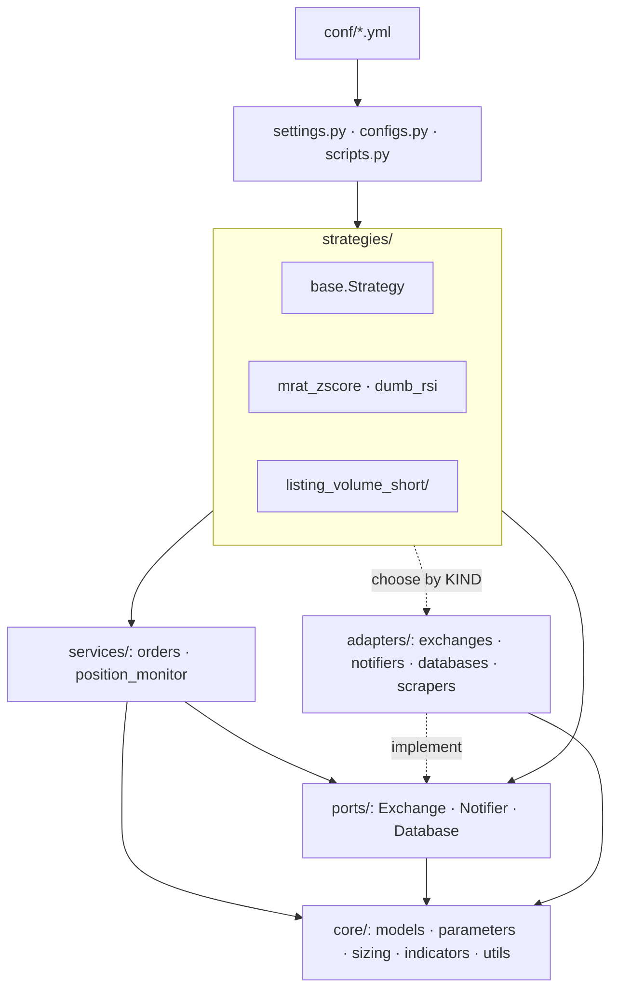

# Architecture

Otomai follows a light hexagonal (ports and adapters) architecture. Strategies and
services talk to **ports**; **adapters** implement them for a vendor; YAML picks the
adapters by `KIND`, and `settings.py` assembles everything.

## Layers

| Layer | Contains | May import |
|---|---|---|
| `core/` | Domain records (`Trade`, normalized exchange records), shared `TradingParams`, pure sizing/liquidity rules, MRAT, enums, exceptions, shared constants | `core` only |
| `ports/` | Abstract `Exchange`, `Notifier`, `Database`; no implementation | `core` |
| `adapters/` | `exchanges/` (`ccxt.py` shared CCXT code, `bitget.py`, `bingx.py`), `notifiers.py`, `databases.py`, `scrapers/` | `core`, `ports` |
| `services/` | Reusable application logic: `orders.py` (open/close a position), `position_monitor.py` | `core`, `ports` |
| `strategies/` | `base.Strategy` and one module or package per strategy, each with its own parameters | everything above |
| top level | `configs.py`, `settings.py`, `scripts.py`: composition and the CLI | everything |

`tests/test_architecture.py` enforces these rules, and that services and strategies
never touch the raw CCXT session or vendor `info` payloads.

## Ports and adapters

The exchange port returns the normalized records of `core/models.py`
(`ExchangePosition`, `ExchangeOrder`, `ExchangeFill`, `ClosedPosition`, `Market`,
`OrderBook`). Positions have positive quantities and an explicit side; zero
placeholders are dropped. Unknown prices/P&L stay `None`; a reported zero is a real
value. Vendor errors that callers act on are translated into domain exceptions
(`OrderNotFound`, `InsufficientFunds`).

`CcxtExchange` implements the port once on top of CCXT; venue subclasses only repair
payload differences and build venue requests:

| Concern | Bitget | BingX |
|---|---|---|
| Credentials | Key, secret, passphrase | Key and secret |
| Account equity | `accountEquity` / `usdtEquity` | Raw account `equity` |
| Closing side | CCXT `hedged` + `reduceOnly` | One-way `BOTH` + `reduceOnly` |
| Open orders | Ordinary plus normal, profit/loss and trailing plans | Unified open orders |
| Fill metadata | `tradeSide`, `profit`, hedge side repair | `positionSide`, `realizedProfit` |
| Trigger price | Venue default | Last price (`CONTRACT_PRICE`) |
| Client-ID lookup | Not implemented | Yes |
| Stock/FX/commodity contracts | — | Flagged `tradfi` in `Market` |

Clients and Telegram bots are lazy: reading a config never connects to an exchange.
Margin/leverage setup failures propagate. An ambiguous order submission is never
retried; only an explicit insufficient-funds rejection may shrink and retry an
entry, keeping its client ID.

## Strategies

Each strategy owns its parameter class (subclass of `core.parameters.StrategyParams`)
and declares the `TradingParams` flavour it needs. `base.Strategy` provides the
shared `open_position` (size, place, notify, then start the `PositionMonitor`) and
`position_opening_available`.

`listing_volume_short/` is a package because it keeps durable state:

| Module | Role |
|---|---|
| `params.py` | Signal and risk parameters |
| `signal.py` | Pure rules: universe, listing hour, entry window, first-window volume, reference median |
| `state.py` | Typed `Listing` record and its SQLite store (process lock, frozen identity, events) |
| `execution.py` | Portfolio admission and entry orders |
| `lifecycle.py` | Protection, deadline exits, adoption after state loss |
| `strategy.py` | Discovery and the polling cycle composing the above |

It depends on the exchange port, except that it is configured with the BingX
adapter: restart safety needs client-ID order lookup, which only BingX implements.

## Adding things

- **A venue:** subclass `CcxtExchange` in `adapters/exchanges/`, add it to
  `ExchangeKind`, and test its payload repairs offline.
- **A notifier or database:** implement the port in `adapters/` and add it to the
  matching `*Kind` union.
- **A strategy:** add a module (or package) with its params and a `Strategy`
  subclass, then register it in `strategies/__init__.py`.
